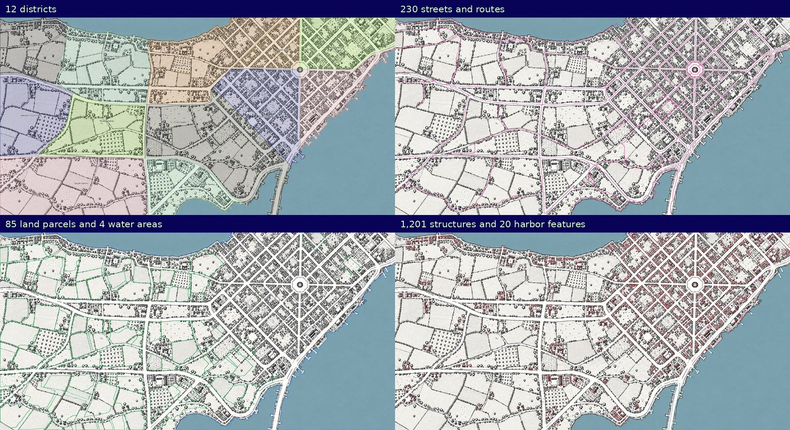

# Grayhaven survey

Grayhaven is rebuilt from `public/assets/maps/grayhaven/map-hires.webp` and the independent authored inputs in `sources/grayhaven/survey.json`. The rebuild does not read the previous generated map. The displayed raster and every saved geometry use the same **3,548 × 1,774** pixel grid.

| Coverage | Entries |
| --- | ---: |
| Ordinary building footprints | 1,189 |
| Individually authored landmark buildings and monument | 12 |
| Streets, lanes, trails and squares | 230 |
| Fields, pastures, orchards and town green spaces | 85 |
| Landing stages and harbor arm | 20 |
| Sea, harbor, bay and inlet | 4 |
| Total locations | 1,540 |
| Districts | 12 |



## Workflow and review

The Dragonsgate authoring pipeline is the reference: establish authored controls, extract geometry from the raster, inspect the resulting overlays, save street references, then validate the complete map. Grayhaven uses separate raster parameters because its roofs are outlined and hatched rather than predominantly solid dark shapes.

- The survey supplies 26 named route traces. Paving alignment follows the connected light road corridors. Additional town segments come from the corridor skeleton. Field parcels, short paving spurs and winding courtyard artifacts are excluded from automatic street extraction.
- Coastal polygons follow the colored water boundary. They exclude the land, including the harbor arm and landing stages. The harbor basin and western inlet have separate entries.
- Shared district seams follow the roads and rural lanes. Their polygons partition the land without overlapping. Every location has an explicit district. Rural district names describe the farms and commons shown there.
- The 86 authored agricultural and open-space outlines follow visible hedge divisions and curbs. One is the Sunwheel Market square. Their edges are refined against the raster linework and overlapping areas are removed. The other 85 entries are terrain features.
- Roof detection combines enclosed light interiors with dark hatching and density-based separation of connected roof rows. Footprints retain their orientation. Raster outlines replace generic rectangular targets where available.
- The survey contains 315 individually inspected rural roof proposals. Pixel alignment accepts 289 of them. Deduplication retains 285 before landmark suppression. Unsupported proposals are recorded in the audit rather than silently published.
- A review of footprint contact sheets rejects 152 specified tree crowns, hedge marks and ambiguous candidates, including the four previously identified trees. Separate exclusions reject large courtyard shapes that incorrectly merged several buildings.
- Each of the 12 authored points of interest was checked in a close crop. Crown Square follows its octagonal curb and excludes the central monument from its selecting area. Its adjoining streets terminate at the square edge.
- The identity manifest preserves existing building IDs and generation settings where a previous entry matches a new footprint. It contains no old coordinates. Rejected old detections are not retained as invisible or relocated buildings.
- Every building and landing stage links to a mapped street. Ordinary names, households and stories remain deterministic browser-generated content. Building functions, names and district divisions are fictional assignments.

The high-resolution raster is an interpolation of the 1,774 × 887 artwork. Enlarging it does not add new underlying structures. Small attached roofs can share a footprint. Tiny marks that cannot be identified reliably remain part of the artwork. The count is an inventory of saved geometry, not proof of a one-to-one match with every roof mark.

## Viewer

Grayhaven opens with **All places** selected. Building labels appear at closer zooms. The directory and site guide include every saved location even when labels are culled. The overview preserves the map's landscape aspect ratio on desktop and mobile.

## Rebuild and audit

Authoring requires Python with Pillow, NumPy, SciPy, OpenCV, scikit-image and Shapely, plus Node.js 22+. These packages are not browser dependencies.

```sh
python scripts/grayhaven/rebuild.py
python scripts/grayhaven/audit.py
node scripts/register-map.mjs grayhaven
npm test
npm run build
```

`audit.json` records the exact image, survey and generated-map hashes. It verifies district coverage, disjoint parcels, roof anchors, duplicate footprints and saved street references. Its raster check finds **96.88%** of sampled street centerline pixels brighter than gray level 190. Remaining samples include paving marks, narrow paths and dark linework. This check complements visual review rather than establishing the identity of every feature.

Render full-resolution review sheets and twelve building-survey tiles with:

```sh
python scripts/grayhaven/review.py /tmp/grayhaven-review
```

The old `expand-survey.py` command now calls the complete rebuild. It cannot append the retired threshold inventory to the published map.
