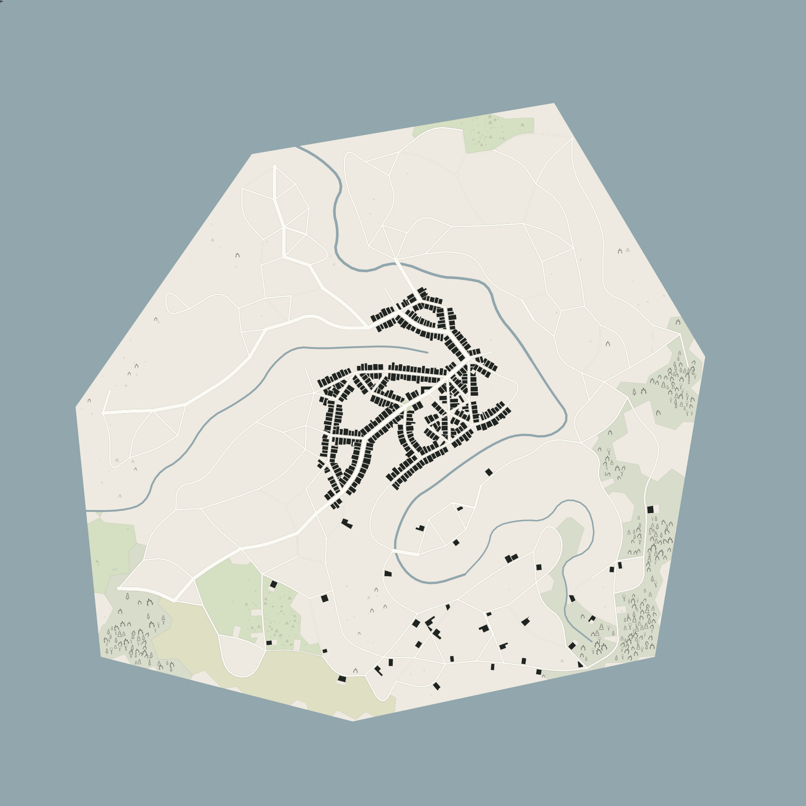

# Organic settlement generation

New regional conversions use layout version 2. Published maps and existing local saves keep their stored geometry. Opening, panning, zooming, changing story settings or exporting a saved map does not rerun layout generation.

This is a synthetic coastline fixture. `npm run preview:layout -- organic-medieval city` reproduces its geometry and decoration. The SVG is a developer review export. The app continues to export PNG artwork and editable atlas backups through its existing interface.

## Pipeline

1. Generate warped simplex elevation and a seeded Poisson/Delaunay terrain mesh.
2. Run a priority flood from water and frame outlets. Condition elevations into an acyclic drainage tree, accumulate rainfall and extract connected river reaches. Relax channel bends while retaining decreasing channel elevation controls.
3. Choose a market center, suitable civic sites and approaches. Place later quarters around the historic center. Settlement type controls street budgets, plot spacing and the building budget.
4. Select bounded river crossings. Never invent a crossing over a lake or ocean. Add approved crossing links to the terrain-routing graph.
5. Connect primary intentions and grow local lanes. A spanning backbone supplies access; selected additional edges provide street circuits and blocks. Routes use irregular mesh edges and slope costs rather than an eight-direction raster.
6. Node line intersections, dissolve shared spans, and merge degree-two chains. Relax synthetic chains with fixed junction endpoints and re-node once. Retained source features keep their original geometry and IDs. Bridges keep a separate crossing level.
7. Buffer the street graph into road corridors and extract buildable blocks. Reserve a market square and, for suitable fully generated cities and fortresses, a keep compound.
8. Divide street frontage into plots. Clip each candidate against its local block and neighboring claims. Require usable area, frontage and access. Plot-specific streams choose dimensions and compound wings.
9. Fit buildings inside inset plots. A keep has a courtyard rather than an oversized rectangular house. Source buildings remain untouched.
10. Use irregular terrain cells and available ground for woodland, meadow and requested rural plots. Water, roads, buildings, civic reservations and claimed plots remain exclusions. The existing terrain classifier handles narrow shoreline remnants and the existing ink sampler adds trees and ground detail.
11. Independently check building footprints against water, streets and other buildings. Allow one inset repair; otherwise leave the plot open and report the capacity shortfall.
12. Assign districts and requested uses using the planned centers, then paint road casings before road interiors so ordinary junctions have no crossing border seams.

## Replay and provenance

`worldImport.procedural.version` is 2. Its `planner` contains the physical precision, pinned component versions, source geometry hash, recipe, passes, founding sites, quarters, street graph, blocks, plots, drainage controls and placement counts. Geometry remains in the app's image-space contract with a single saved metres-per-pixel scale.

Random streams are independent by pass and by stable plot identity. Geometry and IDs use physical coordinates, so changing export resolution preserves physical placement. The source bounds are canonicalized before deriving generation identity. The source geometry and settings remain in the saved map; a seed without the source inputs is insufficient to replay a changing real-world dataset.

Source-detail eligibility still follows region size. Each retained mapped layer suppresses its generated counterpart. Missing, deselected and unavailable layers use generation within the retained constraints. Continental silhouettes use the selected fantasy settlement scale, while backups preserve the original geographic bounds.

Version 1 helper modules remain for released behavior. Do not change the version 2 algorithm or pinned component versions after release without a new layout version. Generated geometry is not a content-generator version change and does not alter released naming catalogs.

## Libraries and build

The planner uses JSTS 2.12.1 for buffering and line topology, polygon-clipping 0.15.7 for polygon overlays, d3-delaunay 6.0.6, simplex-noise 4.0.3 and poisson-disk-sampling 2.3.1. Exact transitive versions are locked in `package-lock.json`. Geometry overlay tests exposed nearly coincident cuts where JSTS alone was insufficient. Polygon overlays therefore share a precision grid and use the focused clipping implementation.

`scripts/planner-vendor.mjs` builds `public/js/vendor/planner.js` from the installed locked packages. The bundle, licenses and release assets are committed. `npm run build` regenerates the bundle before validation and copies the exact source to `dist/`. JSTS is distributed under its EDL-1.0 option; other bundled libraries retain their own notices in `planner-LICENSES.txt`. No external imports, framework or backend are added.

Generation runs in a same-origin module worker. Progress messages name the current pass. Cancel terminates that worker, and results are applied only after successful completion. The exported model contains no generation timestamps, elapsed times or completion-order inputs.

## Verification

`tests/organic-planner.test.mjs` covers partial overlap dissolution, crossing nodes, preserved source and bridge identities, street circuits, bearing diversity, plot access, exact footprint clearance, acyclic downhill drainage, byte-stable replay, resolution invariance, casing order, real worker-message execution and cancellation. Regional tests cover retained source layers, exhausted/deselected layers, coastlines with holes, ocean-only selections and fantasy distance scales.

The elevation field is a cartographic planning surface. It does not model erosion, flooding over time or a three-dimensional geological simulation. Generated channels retain downstream elevation controls. District boundaries still use the app's raster partitioner, seeded from the growth centers. Entire imported street geometries are preserved rather than reshaped into medieval routes.
