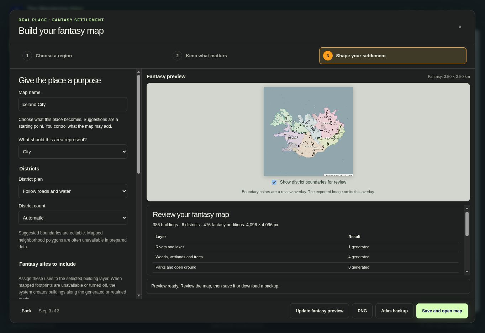
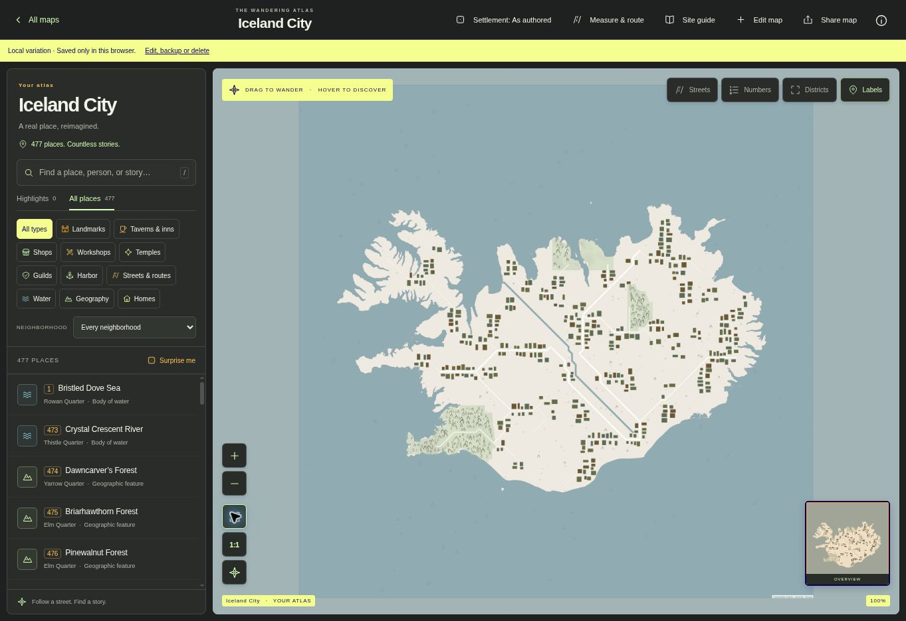
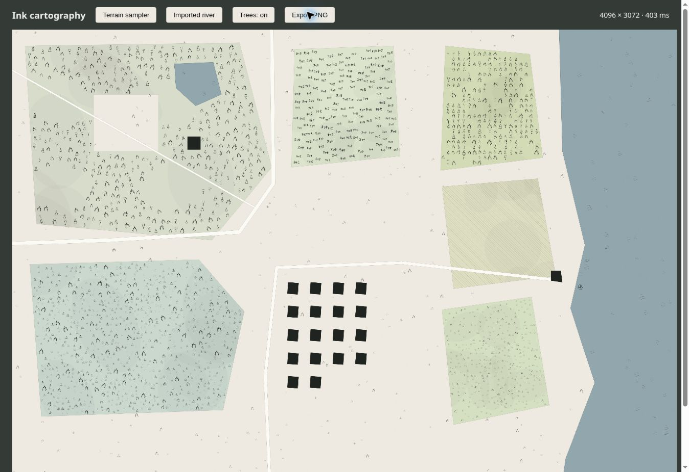
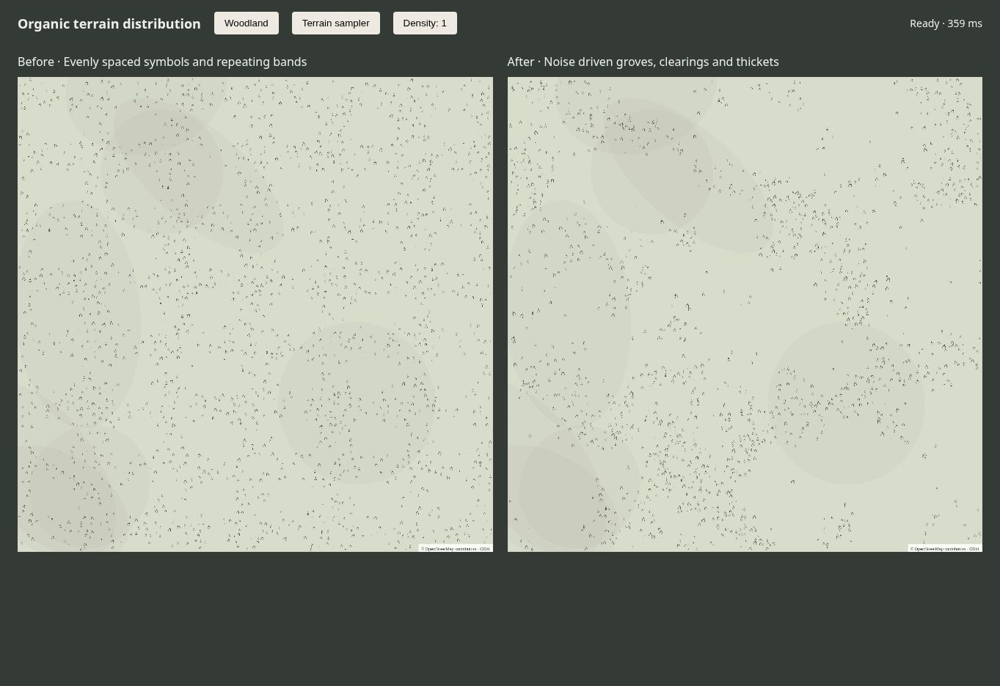

# Create a map from a real place

Open **Real-world map** in the collection. The selected region’s ground coverage decides how much real-world detail is useful. The app can use an island or continent silhouette as the outline of a city and generate the city inside it.

1. **Choose a region.** Pan and zoom or explore an example. The frame shows what will be imported. **Iceland** and **Sicily** fit their outlines on desktop and mobile. Choose image shape and resolution separately. Increasing pixel dimensions does not unlock finer real-world features. The region summary explains which mapped layers are available at the selected coverage. Open its detail table to see the thresholds below. Broad outlines default to settlement distances, so a continent-shaped city has city-scale travel distances. Turn this off to keep real-world distances.
2. **Keep what matters.** **Read region & continue** reads only a bounded cutout at the appropriate detail level. Each layer reports whether it will use mapped geometry or generation. Available source layers can be deselected as a group or feature by feature. Missing, unavailable or entirely deselected layers are generated. Coastline and ocean geometry stay as the land silhouette; inland rivers and lakes can be replaced. A layer with retained mapped features receives no generated counterpart. For example, retained city streets suppress generated city streets while missing buildings can still be generated along those streets. Individual omissions do not trigger duplicates while other source features in that layer remain.
3. **Shape your settlement.** Choose its type, fantasy sites, districts, residents and optional rural parcels. The plan lists which structural layers will be mapped or generated. New roads avoid water and retained buildings. Generated roofs face available streets and avoid roads, water, existing structures and retained terrain parcels. Requested rural land uses reserve clear ground before new roofs are placed. Source building uses can be reimagined or retain mapped hints.

| Longest side of the frame | Mapped detail eligible for use |
| --- | --- |
| Over 300 km | Coastline and land silhouette |
| 40 to 300 km | Also inland rivers, lakes, woodland and wetlands |
| 8 to 40 km | Also principal routes |
| 2 to 8 km | Also connecting roads, agricultural parcels and open land |
| 600 m to 2 km | Also city streets, building footprints and burial grounds |
| Up to 600 m | Also alleys, service routes and footpaths |

Eligibility does not guarantee coverage. The source survey shows what was actually found. Thresholds use the longest ground dimension, independently of image resolution and device viewport. Downloads use an appropriate vector tile zoom and never try to retrieve a continent at building detail. Broad selections use prepared geometry. Live Overpass queries retain the 36 km² limit and are available only for selections no more than 8 km across. Selections must remain within the map’s poles and date line and span at least 40 metres per side.

**Create fantasy preview** uses the loaded data without another download. Review per-layer mapped and generated counts, requested sites and placement warnings. A layer may remain empty where safe placement is impossible. A pure-ocean selection never receives floating buildings. The source outline is not silently replaced after a service failure. Missing source geometry in a successful empty cutout is treated as available land and the source survey shows that no coastline was found.

Move back or use the step navigation to revise choices. Manual settlement choices remain until you explicitly reapply suggestions. Changing source or fantasy choices invalidates the old fantasy preview. Cancel keeps the current choices. Preview boundary colors are a review overlay and are omitted from exported artwork.

Download the PNG, download an atlas backup, or **Save and open map**. Backups keep exact source and generated geometry, source bounds, source eligibility, layer choices, omissions, generation version, seed and distance interpretation. Maps remain on this browser until backed up. Previously saved maps and authored maps retain their existing geometry and generation behavior.

The navigation map offers OpenStreetMap streets and OpenTopoMap terrain. If one provider is unavailable, select the other. Navigation tiles are never included in the exported artwork or bulk downloaded.

The saved Iceland-shape example below keeps the ocean outline and generates the inland city. It uses 386 generated building footprints, three main routes, seven connecting roads, 45 local streets, 30 alleys, a river and four woodland areas. Real Icelandic roads and buildings are not imported.

## Architecture

Runtime uses browser APIs and ES modules with no framework, map-library dependency, key or backend. `world-view.js` implements a slippy tile viewport with pointer dragging, pinch zoom, wheel zoom, double click and keyboard controls. `geo.js` defines the crop, Web Mercator projection and image clipping.

`region-scale.js` computes source eligibility and an appropriate tile zoom from the geographic frame. `prepared.js` is the default data path. It downloads a spatial cutout from the fixed `https://data.source.coop/protomaps/openstreetmap/v4.pmtiles` archive. The provider lists that snapshot as March 31, 2026. `pmtiles.js` reads only the archive header, relevant directories and vector tiles at the chosen zoom (up to 15) using HTTP byte ranges. A server returning a whole-file response is rejected before its body is consumed. Imports use at most four concurrent requests, 96 tiles and 20 MiB of transferred bytes, with a 60-second overall deadline and a 15-second per-range deadline. No whole-planet download, background prefetch, map package or backend is required.

`mvt.js` decodes the vector-tile schema directly. `prepared-geometry.js` maps building, road, water and land features to the same compact geometry inputs used by live imports. `tile-seams.js` cancels shared polygon edges to join buildings across tiles and preserve courtyards. Tile buffers are clipped before joining so structures are not duplicated. Prepared snapshots contain curated and sometimes simplified geometry, rather than every OpenStreetMap tag. Individual building detail is read at zoom 15 for city and block selections. Broader requests filter unsupported source layers before geometry assembly. Tile counts are estimated before enumeration, with a regional target of at most 64 tiles and a hard cap of 96. Snapshot provenance and attribution remain in backups.

The optional live source remains available. `source.js` makes bounded Overpass POSTs to Private.coffee with the main Overpass API as a fallback. Each attempt has a 15-second deadline covering connection, headers, body download and decoding. A stalled first service automatically switches to the second. Network and server errors can fail over; rate limits and oversized responses cannot. The most recently successful service is tried first for subsequent selections. The latest complete result is cached for style changes.

The modal shows elapsed time and received kilobytes. **Cancel** stops a download or render without discarding the selection and settings. Both a caller abort and the deadline explicitly settle the request, even if a browser does not settle its underlying fetch or body reader. Deadlines are checked again when a suspended page resumes. Streamed responses are capped at 12 MiB even without a Content-Length header. Incomplete responses and late replies are never cached. A small area can still be delayed by a public service queue; a smaller crop is not always the remedy.

`osm.js` stitches multipolygon members and preserves holes. `source-selection.js` applies retained feature groups and individual omissions before generation. New regional imports use version 2 choices with a fixed coastline and optional inland water. Version 1 callers preserve their previous water-retention behavior. `source-review.js` draws the source survey without fictional additions and supports water-aware hit testing. `wizard-summary.js` describes planned and actual results. `wizard-markup.js` keeps the interface separate from the dialog controller.

`model.js` converts source geometry directly into the compact atlas schema. Building polygons, clipped road centerlines, water and land all use the same projection as the renderer. Roads have inferred physical widths when source widths are missing. Nearby buildings reference imported roads. Building and geographic names are regenerated. Mapped district names are retained only when you choose mapped boundaries. Source addresses are not copied into generated text. OSM identifiers remain part of location IDs. The selected bounds and seed determine the generation identity, independently of the new local storage ID. Broad imported linework is restyled to the fantasy settlement’s scale while its route coordinates remain intact.

`coast.js` handles connected coastline segments and islands. Coastlines must form closed rings or connect across the export frame. Incomplete coast chains cannot reliably define a sea area and are skipped. Entirely unmapped offshore selections cannot be imported.

`render.js` draws vectors into a label-free image, with seeded textures and ink symbols. Full-size exports are rendered at their requested pixel dimensions rather than enlarged from the preview. The atlas model is saved directly, without raster recognition. Distance calibration is approximate ground scale at the selection's central latitude.

### Procedural structure

`procedural-layout.js` decides once per layer whether to retain mapped features or generate a counterpart. A selected layer with mapped features suppresses generation for that layer. A missing layer, a layer unavailable at the selected coverage or a layer with no retained features uses generation. Agricultural and burial parcels remain optional settlement requests. Coastal water always stays to preserve the outline.

New imports use the [version 2 organic planner](organic-generation.md). It generates a warped elevation field and irregular terrain mesh, conditions drainage from outlets, establishes founding centers and growth quarters, connects primary routes, and adds local street circuits. It resolves shared spans and junctions into a street graph before extracting blocks and frontage plots. Building footprints fit inset plots and keep compounds have courtyards. Approved river crossings remain explicit bridges. A final clearance pass repairs or leaves out constrained footprints without moving retained geometry. The existing landscape classifier and ink sampler supply context-sensitive terrain and decoration.

Generation runs in a same-origin module worker, reports its current pass and can be cancelled. Selected mapped layers still suppress their generated counterparts. Source eligibility and fantasy distance scaling retain the same region-size rules.
`shape-probe.js` caches shape bounds and indexes polygon edges by row. Placement and cartography use these exact indexed collision checks so complex continent outlines do not rescan every coastal vertex for each roof or terrain symbol. Courtyards, concave shores and thin waterways remain exclusions.

Generated structures carry stable `layout-v2-*` IDs and `worldStyle.origin: generated`. `worldImport.procedural` stores the algorithm version, layer decisions, counts, warnings and the planner recipe. The planner persists its graph, plots, blocks, drainage controls and growth centers. Existing `procedural-v1-*` saved geometry remains unchanged. `worldImport.regionPlan` records coverage and source eligibility. `worldImport.distanceScale` keeps the original width separately from the fantasy width. Exporting, saving and reopening reuse stored geometry and do not rerun layout generation.

### Hand drawn terrain

New imports use locally bundled symbols from [Kenney's Cartography Pack](https://kenney.nl/assets/cartography-pack), released under CC0. The original license and asset provenance are in `public/assets/cartography/`. The export metadata records the symbol source and license separately from OSM geometry. The renderer tints the strokes to the selected ink color. Grass, reeds, subtle land washes and gently uneven crop furrows supplement the pack.

`decoration-plan.js` selects tree variants and places irregular woodland clusters with open glades. Marshes receive reeds, small shrubs and water marks. Cemeteries receive varied burial groups, orchards retain loose rows and pasture receives grass and occasional stones. Sparse grass, shrubs and stones break up unclassified open ground, using the settlement's woodland or wetland environment when supplied. Boats appear only on navigable water near an imported or established harbor. Small ripple groups also decorate open water. These marks are decoration, not surveyed objects or additional searchable locations.

The synthetic terrain sampler below demonstrates the symbols, parcel holes and obstruction handling. It is a renderer review fixture, not a surveyed settlement.

The plan uses the import seed, feature IDs and image coordinates. Preview and full-resolution exports share the same placements. Local storage IDs, feature array order and preview size do not affect the plan. `decoration-geometry.js` indexes road, water and building geometry and checks each symbol's complete rotated footprint. Parcel holes, narrow roads, concave boundaries, roofs and the image edges remain clear. Vegetation uses a smaller spacing core so neighboring canopies and grass clumps can overlap into thickets; boats, graves and rocks retain their full separation. Water is painted over terrain so overlapping source land-cover polygons cannot hide rivers. Density zero removes woodland, orchard, park and mapped tree marks while retaining burial, wetland and harbor detail.

`decoration-noise.js` supplies a seeded, continuous field shared across the map. Domain warping bends the sampling coordinates, and three noise scales combine broad groves, smaller clusters and local variations. Nonlinear density filtering leaves clearings and concentrates vegetation in richer patches. The field also groups reeds, meadow details and water ripples, and varies symbol sizes locally. Orchards retain planted rows and burial grounds retain recognizable groups with gentler density variation. Mapped individual trees stay at their source coordinates. Raising tree density adds candidates in the same groves and preserves open glades, including on large parcels that previously hit the attempt cap at every slider setting.

The comparison uses the same synthetic woodland parcel and density setting. The left image shows the earlier distribution; the right shows warped noise and looser canopy spacing.

Placement uses bounded attempts, at most 14,000 symbols, spatial bins and periodic cancellation checks. Symbols load from one same-origin spritesheet and remain safe for PNG and thumbnail export. Existing saved map images and authored Dragonsgate/Grayhaven artwork are retained. Reimport a location to create artwork with the new style.

## Coverage and review

Building uses and stories are fictional. OSM footprints and land-cover coverage vary by location. Missing buildings and individual trees cannot be recovered from the navigation tiles. Woodland symbols are decorative, procedurally placed within mapped woodland, and do not claim surveyed tree positions. Suggested districts use a bounded planning grid with roads as crossing costs and water as barriers. Boundaries follow the selected geography rather than rectangular divisions. A single district can contain disconnected land. Live imports can reuse mapped neighborhood polygons; when those are unavailable the preview reports a fallback to suggested districts. The district count is a target bounded by the available planning cells and buildings. District geometry and household inputs remain editable after saving.

Mapped agricultural land uses retain specific farmland, pasture, orchard or vineyard types through per-map catalogs. Crop rows, grazing marks and orchard symbols distinguish them in the artwork. Cemeteries become searchable burial sites. Nearby buildings link to water and terrain, so resources, occupations and connected quests use their local context. Generated additions record `worldStyle.established`; import preferences and any placement warnings are stored in `worldImport.settlement` and `worldImport.planning`. Review cropped polygons, coastlines and missing features after import.

## Services and attribution

Navigation requests use the browser's normal cache and Referer and request only visible tiles. Never add tile prefetch or offline tile scraping. Links:

- [OSM tile policy](https://operations.osmfoundation.org/policies/tiles/)
- [OpenTopoMap usage and attribution](https://opentopomap.org/about)
- [Overpass by Private.coffee terms and privacy](https://overpass.private.coffee/)
- [Protomaps snapshot and cutout downloads](https://source.coop/protomaps/openstreetmap/v4.pmtiles)
- [PMTiles archive specification](https://github.com/protomaps/PMTiles/blob/main/spec/v3/spec.md)
- [Protomaps layer schema](https://docs.protomaps.com/basemaps/layers)
- [Main Overpass API usage guidance](https://dev.overpass-api.de/overpass-doc/en/preface/commons.html)
- [OSM copyright and ODbL](https://www.openstreetmap.org/copyright)

Attribution remains visible in navigation and exported artwork. Backups include ODbL and source links. Distributed derived geometry remains subject to ODbL. Keep source-geometry licensing separate from generated story text. For larger traffic, configure an appropriate hosted or self-hosted data service and update the explicit origins in `public/_headers` alongside the service URLs. No API secrets belong in browser code.

## Continuous water features

`water.js` stitches adjoining water polygons even when adjacent source tiles use different IDs. It joins unbranched centerlines and removes centerlines fully covered by riverbank areas. Islands remain exclusions. Distinct water types, named tributaries and disconnected lakes retain their identities. Partial centerline coverage never removes an uncovered reach. The largest source area supplies the surviving location ID, site number and deterministic name. `locationAliases` redirects former fragment IDs and geographic references to that survivor.

Previously saved world imports reconcile water on opening when their water inputs still match the original import. Original images and import snapshots remain intact. Edited water is left for manual review. The next ordinary save persists the repaired geometry and rebuilt indexes. Existing maps do not gain unrequested settlement setup or fictional farmland automatically.
